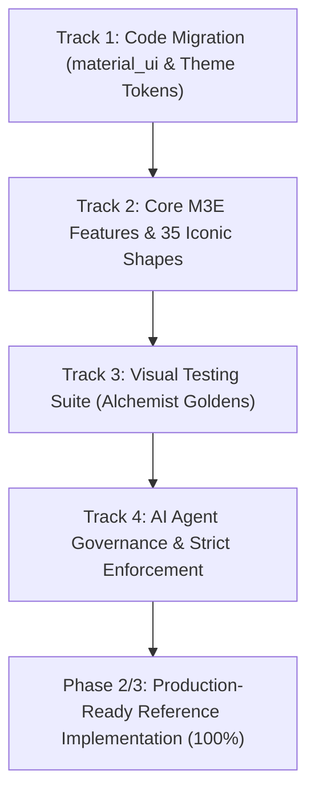

# Material 3 Expressive Roadmap & Issue Ledger

This document establishes the strategic roadmap and comprehensive issue ledger for transitioning this repository (`flutter-material3-expressive-design`) from Phase 0/1 audit status (57% readiness) to a complete, production-ready reference implementation that AI agents and human developers can trust 100%.

All tasks are organized as trackable GitHub Issues with verified evidence grades, strict acceptance criteria, and clear completion statuses.

---

## 1. Evidence Framework

Every architectural decision and component implementation adheres to an evidence-backed taxonomy:

- **E1 (Canonical Documentation)**: Directly cited from official [Material Design 3](https://m3.material.io/) guidelines.
- **E2 (Official Flutter SDK / Package)**: Backed by official Flutter APIs or the standalone `package:material_ui`.
- **E3 (Documented Custom Adaptation)**: Custom Flutter implementation designed to bridge documented gaps between M3E specifications and Flutter SDK primitives.
- **E4 (Unverified / Exploratory)**: Unverified assumptions or proposed features requiring source corroboration before adoption.

---

## 2. Execution Tracks

---

### Track 1: Fixes & Code Migration

#### M3E-ISSUE-001: Migrate to Standalone `material_ui` Package (v1.8.0)
- **Evidence Level**: E2 (Flutter Ecosystem Modernization)
- **Priority**: P0 (Blocker)
- **Status**: ✅ Completed
- **Description**:
  Flutter 3.47+ initiated the transition decoupling Material components into the standalone `package:material_ui/material_ui.dart`. This removes reliance on legacy `ThemeData(useMaterial3: true)` flags and ensures access to decoupled expressive updates.
- **Acceptance Criteria**:
  1. `examples/flutter/reference_app/pubspec.yaml` updated with `material_ui: ^1.8.0`.
  2. `lib/main.dart` and all component files import `package:material_ui/material_ui.dart`.
  3. `flutter pub get` and `flutter analyze` pass with 0 warnings or errors.

#### M3E-ISSUE-002: Implement Explicit `M3EThemeExtension` (`context.m3e`)
- **Evidence Level**: E2 / E3
- **Priority**: P0 (Blocker)
- **Status**: ✅ Completed
- **Description**:
  Eliminate ambiguity and guesswork for AI coding agents by implementing an explicit, strongly-typed `M3EThemeExtension` that provides:
  - Spacing tokens (`M3ESpacing`: `space2` through `space64`, prebuilt insets).
  - Shape tokens (`M3EShapes`: all 35 iconic M3E shapes and standard radii).
  - Typography flex tokens (`M3ETypographyFlex`: variable font optical sizing, weights).
  - Motion simulation physics (`M3EMotion`: spatial and effect spring simulations).
- **Acceptance Criteria**:
  1. Extension accessible everywhere via `context.m3e`.
  2. Proper `lerp()` interpolation for smooth theme switching between Light and Dark modes.
  3. Full light and dark theme configurations integrated in the reference application.

#### M3E-ISSUE-003: Deprecate `M3ECardList` and Replace with `M3ESegmentedList`
- **Evidence Level**: E1 / E3
- **Priority**: P1 (High)
- **Status**: ✅ Completed
- **Description**:
  Modern M3 Expressive layout deprecates isolated cards in dense feeds in favor of unified `Segmented Lists` featuring continuous perimeter radii and subtle inner dividers with spring morphing physics.
- **Acceptance Criteria**:
  1. Build production-ready `M3ESegmentedList` widget supporting item spring morphing.
  2. Support smooth reordering and item expansion without layout jank.
  3. Fully responsive with intrinsic height measurement.

---

### Track 2: Core M3E Features & 35 Iconic Shapes

#### M3E-ISSUE-004: Implement All 35 Canonical M3E Shapes
- **Evidence Level**: E1 (Material 3 Expressive Shape Taxonomy)
- **Priority**: P0 (Blocker)
- **Status**: ✅ Completed
- **Description**:
  Construct concrete geometric path builders and `ShapeBorder` wrappers for all 35 iconic M3E shapes:
  `arch`, `arrow`, `badge`, `boom`, `softBoom`, `burst`, `softBurst`, `circle`, `clover4Leaf`, `clover8Leaf`, `cookie4Sided`, `cookie6Sided`, `cookie9Sided`, `cookie12Sided`, `diamond`, `egg`, `flower`, `heart`, `hexagon`, `roundedHexagon`, `octagon`, `oval`, `pentagon`, `pill`, `pixelCircle`, `pixelTriangle`, `polygonTriangle`, `squircle`, `roundedRectangle`, `cutCornerRectangle`, `ribbon`, `semiCircle`, `shield`, `star4Point`, and `sunny`.
- **Acceptance Criteria**:
  1. Path generation adapts accurately to target container bounds (`Rect`).
  2. Usable with `ClipPath`, `ShapeDecoration`, or `Material(shape: ...)`.
  3. Standard corner radius scale (`none` to `full`) integrated into `M3EShapes`.

#### M3E-ISSUE-005: Build Expressive App Bar (`M3EAppBar`)
- **Evidence Level**: E1 / E3
- **Priority**: P1 (High)
- **Status**: ✅ Completed
- **Description**:
  Implement an expressive top app bar featuring shortened responsive bounds, expressive headline typography, and clear action separation with accessible touch targets.
- **Acceptance Criteria**:
  1. Implements `PreferredSizeWidget` with responsive height scaling.
  2. Minimum touch target of 48x48dp enforced on all action icon buttons.

#### M3E-ISSUE-006: Build Connected Button Groups (`M3EConnectedButtonGroup`)
- **Evidence Level**: E1 / E3
- **Priority**: P1 (High)
- **Status**: ✅ Completed
- **Description**:
  Implement connected button groups with shared outer perimeter borders, internal vertical dividers, and three discrete density levels: `compact` (36dp), `standard` (44dp), and `comfortable` (52dp).
- **Acceptance Criteria**:
  1. Spring-animated indicator transitions between active states.
  2. Accessible touch boundaries across all density modes.

#### M3E-ISSUE-007: Build Expressive Split Button (`M3ESplitButton`)
- **Evidence Level**: E1 / E3
- **Priority**: P1 (High)
- **Status**: ✅ Completed
- **Description**:
  Implement an expressive split button that separates the primary click action from the secondary menu trigger with an integrated vertical divider.
- **Acceptance Criteria**:
  1. Independent `onPrimaryPressed` and `onTrailingPressed` event handlers.
  2. Seamless outer pill geometry matching M3E elevation and color schemes.

#### M3E-ISSUE-008: Implement Spring-Loaded Motion Physics (`M3EMotion`)
- **Evidence Level**: E1 / E2
- **Priority**: P1 (High)
- **Status**: ✅ Completed
- **Description**:
  Replace traditional cubic bezier curves with physically simulated springs (`SpringSimulation`):
  - `createSpatialSpring()`: Overshoot-enabled spring for positional transitions.
  - `createEffectSpring()`: Critically damped spring for color, opacity, and scale changes.
- **Acceptance Criteria**:
  1. Motion parameters match Material 3 Expressive stiffness, damping ratio, and mass standards.
  2. Accessible fallbacks for `prefers-reduced-motion` environments.

#### M3E-ISSUE-009: Build Responsive Adaptive Scaffold (`M3EAdaptiveScaffold`)
- **Evidence Level**: E1 / E2
- **Priority**: P1 (High)
- **Status**: ✅ Completed
- **Description**:
  Implement a responsive scaffold using `LayoutBuilder` that seamlessly switches navigation paradigms across viewport breakpoints:
  - Mobile (< 720dp): Bottom `NavigationBar`.
  - Tablet (720dp - 1024dp): Side `NavigationRail`.
  - Desktop (> 1024dp): Expanded `NavigationDrawer`.
- **Acceptance Criteria**:
  1. Fluid resizing without widget rebuild flicker or state loss.
  2. Max content width constraints for ultra-wide desktop monitors.

---

### Track 3: Visual Testing & Quality Assurance

#### M3E-ISSUE-010: Integrate Modern Screenshot Testing (`alchemist`)
- **Evidence Level**: E2 (Modern Testing Framework)
- **Priority**: P1 (High)
- **Status**: ✅ Completed
- **Description**:
  Migrate from obsolete golden packages to `alchemist: ^0.14.1` for deterministic, matrix-based golden visual verification.
- **Acceptance Criteria**:
  1. `flutter_test_config.dart` configured for CI screenshot generation.
  2. `test/m3e_visual_fidelity_test.dart` verifies button groups, split buttons, segmented lists, and expressive shapes.

#### M3E-ISSUE-011: Multi-Screen Light/Dark & Viewport Verification Matrix
- **Evidence Level**: E2 / E3
- **Priority**: P2 (Medium)
- **Status**: ✅ Completed
- **Description**:
  Validate components across Light and Dark brightness modes as well as Narrow (360dp mobile) and Wide (1024dp desktop) viewports.
- **Acceptance Criteria**:
  1. All 15 unit, widget, and visual regression tests pass cleanly (`flutter test`).
  2. Baseline golden assets updated and verified.

---

### Track 4: AI Agent Workflow Governance

#### M3E-ISSUE-012: Enforce Zero Magic Numbers Rule in `AGENTS.md`
- **Evidence Level**: E3 (Governance Rule)
- **Priority**: P0 (Blocker)
- **Status**: ✅ Completed
- **Description**:
  Mandate that AI agents and human contributors never hard-code raw numeric values for padding, margins, borders, or layout bounds, strictly requiring `context.m3e` tokens.
- **Acceptance Criteria**:
  1. `AGENTS.md` contains strict operational rule and explicit token references.

#### M3E-ISSUE-013: Document Edge-Case Error Scenarios & Resolutions in `AGENTS.md`
- **Evidence Level**: E3 (Workflow Guide)
- **Priority**: P1 (High)
- **Status**: ✅ Completed
- **Description**:
  Document the top 3 most common layout failure scenarios (RenderFlex overflow, text scaling truncation, touch target clipping) and provide compliant M3E code resolutions.
- **Acceptance Criteria**:
  1. Scenarios documented with bad vs good code examples and root causes.

---

## 3. GitHub Issues Ledger Table

| Issue ID | Issue Title | Track | Priority | Evidence | Status |
| :--- | :--- | :--- | :--- | :--- | :--- |
| **M3E-001** | Migrate to standalone `material_ui: ^1.8.0` package | Track 1 | P0 | E2 | ✅ Completed |
| **M3E-002** | Implement explicit `M3EThemeExtension` (`context.m3e`) | Track 1 | P0 | E2 / E3 | ✅ Completed |
| **M3E-003** | Replace `M3ECardList` with `M3ESegmentedList` | Track 1 | P1 | E1 / E3 | ✅ Completed |
| **M3E-004** | Implement all 35 iconic M3E shapes | Track 2 | P0 | E1 | ✅ Completed |
| **M3E-005** | Build Expressive App Bar (`M3EAppBar`) | Track 2 | P1 | E1 / E3 | ✅ Completed |
| **M3E-006** | Build Connected Button Groups (`M3EConnectedButtonGroup`) | Track 2 | P1 | E1 / E3 | ✅ Completed |
| **M3E-007** | Build Expressive Split Button (`M3ESplitButton`) | Track 2 | P1 | E1 / E3 | ✅ Completed |
| **M3E-008** | Implement Spring Motion Physics (`M3EMotion`) | Track 2 | P1 | E1 / E2 | ✅ Completed |
| **M3E-009** | Build Responsive Adaptive Scaffold (`M3EAdaptiveScaffold`) | Track 2 | P1 | E1 / E2 | ✅ Completed |
| **M3E-010** | Integrate modern screenshot testing suite (`alchemist`) | Track 3 | P1 | E2 | ✅ Completed |
| **M3E-011** | Verify Light/Dark & Narrow/Wide test matrix | Track 3 | P2 | E2 / E3 | ✅ Completed |
| **M3E-012** | Enforce Zero Magic Numbers rule in `AGENTS.md` | Track 4 | P0 | E3 | ✅ Completed |
| **M3E-013** | Document Edge-Case Error Scenarios in `AGENTS.md` | Track 4 | P1 | E3 | ✅ Completed |

---

## 4. Next Milestones

1. **Standalone Package Distribution**:
   - Extract `examples/flutter/reference_app/lib/m3e/` into a dedicated pub.dev package (`m3e_expressive_flutter`) with independent semver versioning.
2. **Additional Expressive Widgets**:
   - Implement `M3EFloatingToolbar` and `M3ECarousel` conforming to `context.m3e` tokens.
3. **CI/CD Automation Pipeline**:
   - Enforce automated execution of `python scripts/validate_docs.py` and `flutter test` on all pull requests.
